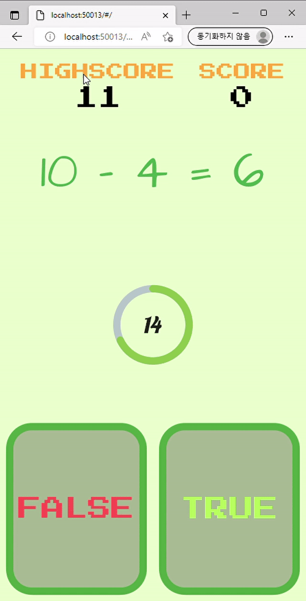
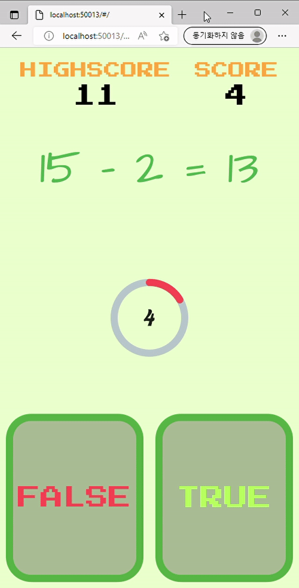

## 짱구야 숙제하자📖(Math Quiz Game)
랜덤으로 출제되는 사칙 연산 문제를 푸는 게임입니다.

APK file 
 

## Technology we've used 🛠
  
 

## Screens 📱
### Welcome Screen 👋

게임 실행 시 나오는 첫 화면입니다. 앱 이름인 "짱구야 숙제하자" 텍스트가 중앙에 배치되어 있고, Tap To Start 버튼이 반복적인 그라데이션 애니메이션으로 활성화되어있습니다.
아무 곳이나 눌러서 게임을 실행할 수 있습니다.

  

### Game Screen 🕹️

게임을 시작하면 숫자가 줄어듭니다. 제한시간 안에 문제를 풀어야 하며, 문제를 맞추면 시간이 늘어나고 틀리면 줄어듭니다. 
숫자가 0이 되면 게임이 종료됩니다.

  

게임이 종료되면 "GAME OVER" 팝업이 뜨면서 게임을 다시 시작할지, 종료할지 선택할 수 있습니다.

  

## Contributors 🔥

